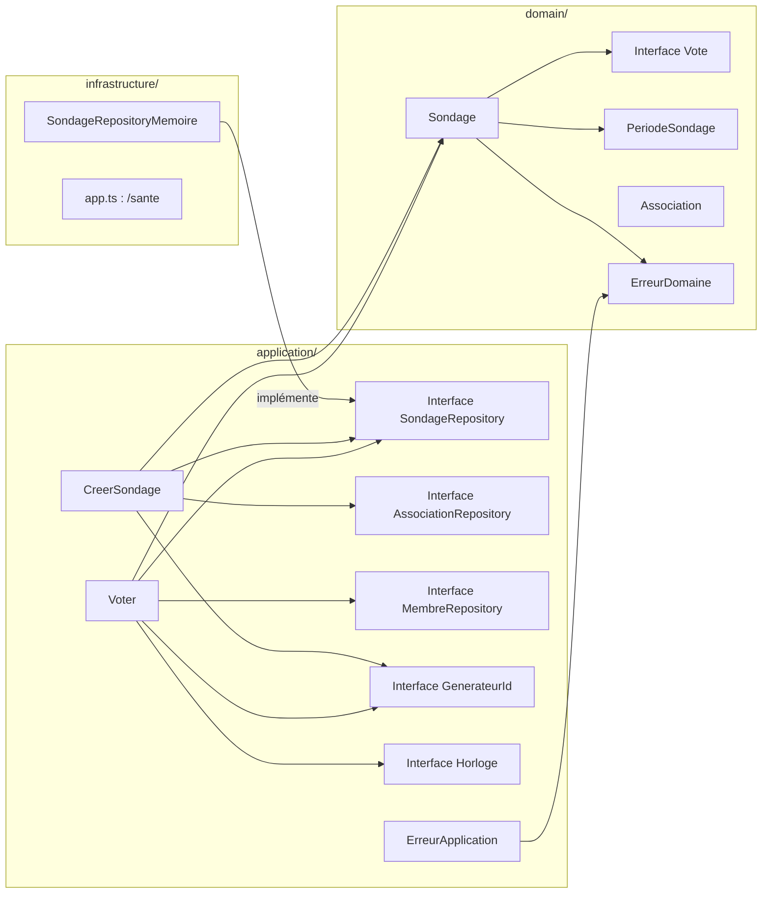

# Sondages pour associations

Le projet comprend deux services TypeScript : `auth-service` pour les comptes et
`sondage-service` pour les sondages liés à une association. Les membres d'une
association peuvent voter à ses sondages.

## État du projet et référents

| Composant | Référent | État actuel |
|---|---|---|
| Authentification (`auth-service`) | Enzo | Inscription HTTP avec hachage Argon2id et stockage PostgreSQL. Connexion et jetons à construire. |
| Domaine du sondage (`Sondage`, `Vote`) | Svetlana | Agrégat, période de vote et règles métier. |
| Domaine des associations et périodes | Enzo et Mattias | `Association` et `PeriodeSondage`. |
| Cas d'usage et ports (`sondage-service/application`) | Mattias | `CreerSondage`, `Voter`, ports et erreurs d'application. |
| Repository en mémoire (`sondage-service/infrastructure/memoire`) | Mattias | Stockage de copies des sondages. |
| HTTP du service sondage (`sondage-service/infrastructure/http`) | Mattias | Route `/sante` et documentation OpenAPI minimale ; création et vote non encore exposés. |

## Lancer les tests

Prérequis : Node.js 22 et npm. Les tests unitaires et HTTP n'utilisent pas
Docker.

```bash
cd sondage-service
npm install
npm test
npm run typecheck
npm run test:architecture
```

`npm test` exécute les tests du domaine, des deux cas d'usage, du repository en
mémoire et de la route de santé. Les tests de `CreerSondage` et `Voter` utilisent
`SondageRepositoryMemoire` et des identifiants prévisibles ; `Voter` utilise
aussi une horloge fixe. Ils couvrent le cas nominal, les invariants violés et
les ressources introuvables. Dernière vérification : 40 tests verts sans Docker.
La durée affichée par Vitest a varié de 835 ms à 1,15 s selon l'exécution.

Pour tester `auth-service` séparément :

```bash
cd auth-service
npm install
npm test
```

Pour lancer les services et leurs dépendances :

```bash
docker compose up -d --build
```

Le service sondage expose actuellement `GET http://localhost:3000/sante` et
`http://localhost:3000/docs`. Le service d'authentification écoute sur le port
3001. Les tests d'intégration nécessitant PostgreSQL, RabbitMQ ou Redis se
lancent avec `npm run test:integration` dans le service concerné.

## Couches du service sondage



Les flèches représentent les dépendances du code : `infrastructure` dépend des
ports d'`application`, et `application` utilise les objets de `domain`. Le
domaine ne dépend d'aucune autre couche.

| Couche | Autres classes et interfaces présentes |
|---|---|
| `domain/` | Interfaces `SondageProps` et `AssociationRepository` (locale, non utilisée) ; classes `QuestionVide`, `OptionsInsuffisantes`, `OptionsEnDouble`, `SondageHorsPeriode`, `DejaVote`, `BulletinVide`, `OptionInconnue`, `ChoixEnDouble`, `ChoixUniqueDepasse`. Types `NouveauSondage` et `ModeDeChoix`. |
| `application/` | Classes `AssociationIntrouvable`, `SondageIntrouvable` et `MembreRequis`, définies près des cas d'usage qui les déclenchent. |
| `infrastructure/` | `construireApp` dans `http/app.ts` est une fonction, pas une classe ; le repository en mémoire est la seule classe d'infrastructure du sondage actuellement. |

Le module HTTP du service sondage n'est pas encore relié aux cas d'usage.
`AssociationRepository` et `MembreRepository` n'ont pas encore d'implémentation
concrète dans ce service. `Association.ts` contient aussi une interface locale
`AssociationRepository` non utilisée ; le port employé par `CreerSondage` est
celui d'`application/ports.ts`.

`SondageRepositoryMemoire` fait une copie à chaque lecture et enregistrement :
modifier un sondage chargé ne modifie pas la version stockée avant l'appel à
`enregistrer`. Ce stockage est temporaire ; l'adaptateur PostgreSQL du sondage
reste à écrire. Le schéma SQL du service sondage est encore un emplacement vide.

## Contrats et commandes utiles

| Commande | Rôle |
|---|---|
| `npm test` | Tests unitaires et HTTP, sans Docker |
| `npm run typecheck` | Vérification des types TypeScript |
| `npm run test:architecture` | Vérification du sens des dépendances entre couches |
| `npm run lint:contrat` | Validation du contrat OpenAPI |
| `npm run test:integration` | Tests avec les dépendances réelles, si présents |

Le contrat de communication prévu entre services est HTTP/OpenAPI ; les variables de
connexion à PostgreSQL, RabbitMQ et Redis sont définies dans `compose.yaml`.
Après une modification de `db/schema.sql` sur une base locale jetable, recréer
les volumes Docker pour appliquer le nouveau schéma.

L'usage de l'assistant d'IA est consigné dans [IA.md](IA.md).
